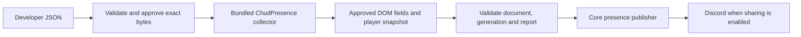

# ChudPresence Activity API V2

V2 is the public, declarative Activity API introduced in the Chromium lab 2.0.0.
Developers describe which media information to inspect. ChudPresence owns the
JavaScript that reads those fields, samples the player, and submits presence.
An installed V2 package contains no executable JavaScript.

[V1](https://github.com/ChudForks/ChudPresence-Activities/blob/main/ACTIVITY_API.md) remains available for trusted first-party integrations and
explicitly trusted local development. V2 does not expose V1's SDK or page bridge.

## Quick start

Create a folder with the following two files. Optionally include `icon.png` for
the Library card and declare `"icon": "icon.png"` in metadata.

`metadata.json`:

```json
{
  "id": "example-video",
  "name": "Example Video",
  "description": "Show media playback from Example Video.",
  "version": "1.0.0",
  "apiVersion": 2,
  "minExtensionVersion": "2.0.0",
  "matches": ["https://example.com/watch/*"],
  "excludeMatches": ["https://example.com/watch/private/*"],
  "entry": "activity.json"
}
```

`activity.json`:

```json
{
  "schemaVersion": 1,
  "kind": "video",
  "scope": "#player",
  "fields": {
    "title": {
      "source": "dom.text",
      "selectors": [".media-title", "h1"]
    },
    "creator": {
      "source": "dom.attribute",
      "selectors": [".media-creator"],
      "attribute": "title"
    }
  },
  "player": {
    "adapter": "html-media",
    "selectors": ["video", "audio"]
  }
}
```

Replace the example selectors with selectors for the actual website. The player
and metadata must be descendants of the same narrow approved container. All
values read from it may appear in Discord when sharing is enabled.

Open Activity Library, enable developer tools, select both JSON files, and click
**Load local Activity**. Review the hosts, container, fields, and player selectors.
**Approve installation** requests missing browser site permissions and approves
the exact staged bytes. Chrome 138+ requires **Allow User Scripts** in extension
details; earlier supported versions use Developer mode. This implementation uses
`chrome.userScripts` to run its bundled collector.

A ready-to-load example is in the lab's `examples/v2/html-media/` directory.

## Execution and data flow



Package contents are parsed with `JSON.parse` and embedded as serialized data
alongside bundled extension functions. They are never evaluated or interpolated
into a function body. There are no developer callbacks or returned DOM objects.

The collector samples once every two seconds, resolving current elements and
checking route scope each time. It therefore handles DOM replacement and SPA
navigation. Missing titles (except the Prime Video retention described below),
missing/unready/ended players, excluded routes, and out-of-scope routes clear
existing reports. Background timer throttling can delay
sampling; this interval is not a timing guarantee.

Each report belongs to an enabled installation generation, top-frame document,
and tab. The worker checks current host permission and rejects stale generations.
Disable, uninstall, and revocation block publication. The collector removes its
timers on teardown/document exit. Startup and extension updates restore approved
stored configurations through the existing Activity Manager.

## Metadata

Required: `id`, `name`, `description`, `version`, `apiVersion`, `matches`, `entry`.
`apiVersion` must be `2`; `entry` must be `activity.json`.

| Field | Contract |
| --- | --- |
| `id` | 2–64 lowercase letters, digits or hyphens, starting with a letter or digit. |
| `name`, `description` | Non-empty text, at most 80 and 500 characters respectively. |
| `version`, `minExtensionVersion` | Semantic versions; minimum extension version is optional. |
| `matches` | 1–32 unique exact public HTTPS host patterns; paths may use `*`. |
| `excludeMatches` | Up to 32 patterns with the same restrictions. |
| `frames` | Omitted or `top`; child-frame execution is unavailable. |
| `icon` | Omitted or `icon.png`; validated PNG up to 256 KB. |

Optional discovery fields: `author`, `contributors`, `category`, `defaultMediaKind`,
`aliases`, `tags`, `repository`, `homepage`, `serviceUrl`, `settingsUi.statusLabels`.
Their bounds are in the metadata schema. Discovery URLs are static metadata, not
output destinations for extracted values. Author fields do not establish trust.

Unknown fields fail closed. `network`, `executionWorld`, custom `settings`,
`presence`, and capability declarations are not accepted. Wildcard hosts, IP
literals, local names, HTTP, ports in match patterns, Discord domains, and
extension/internal URLs are rejected. Host validation does not resolve DNS or
establish a general network firewall.

Chrome grants permissions for an entire origin. The collector and worker enforce
the narrower Activity path scope separately.

## Configuration and field rules

`schemaVersion: 1` identifies the configuration format. It is separate from the
API's `apiVersion: 2` and the package's semantic version.

`kind`: `video`, `movie`, `episode`, `song`, `stream`, `game`, or `generic`.
This initial implementation requires an HTML audio/video player for every kind.

`scope`: a container selector containing an ID or class. The first visible,
permitted container among up to eight matches is selected. All field/player
queries operate inside that container.

`fields`: `title` is required. Optional text fields are `subtitle`, `artist`,
`album`, `series`, `creator`, `channel`, `category`, `game`, and `playlist`.
Numerical season/episode extraction is available only through the bundled
Prime Video details mode below.

| Rule option | Behavior |
| --- | --- |
| `source: "dom.text"` | Read bounded `textContent` only after the element and its descendants pass visibility checks. |
| `source: "dom.attribute"` | Read only `title`, `aria-label`, or `alt`. |
| `selectors` | One to four unique fallback selectors, tried in order. |
| `attribute` | Required for attribute reads; forbidden for text reads. |
| `removePrefix`, `removeSuffix` | Optional non-empty literal strings, at most 64 characters each. |

Whitespace is collapsed and trimmed automatically. Prefix/suffix removal is
literal, followed by trimming. Missing optional values are omitted. Missing title
means no presence. No regex, expression, callback, loop, or method name is accepted.

Selectors support tag, ID, and class compounds, with descendant/child combinators:
`.media-title`, `h1.title`, `#metadata > .creator span`. Attribute/pseudo selectors,
escapes, wildcards, sibling traversal, and comma lists are forbidden. Use the
fallback array. Limit: 256 characters and eight compound parts per selector.

Readable elements are headings, spans, paragraphs, divs, links, strong/bold,
emphasis/italic, small text, and images. Reads exclude root `html`/`body`, sensitive
elements/ancestors such as forms, inputs and editable content, hidden elements,
and subtrees containing sensitive nodes. Targets may have at most 16 descendants.
If any descendant fails the visibility checks (CSS `display: none`, hidden or
collapsed `visibility`, zero opacity, `content-visibility: hidden`, or no layout
rectangles), the entire field is skipped before reading its text or attribute.
Visible nested formatting is supported; use a narrower selector for markup that
mixes visible and hidden content. A rejected title clears presence, and a rejected
optional field is omitted.
Raw values over 1,024 characters are skipped; accepted values are capped at 256.
At most eight candidates per selector are considered.

## Player adapter

`player` accepts `adapter: "html-media"` and one to four fallback `selectors`.
The first visible, permitted, ready audio/video descendant provides:

- `state`: `playing` or `paused`; ended playback clears presence.
- `position`, `duration`: seconds, bounded to one year. Unknown/infinite duration becomes zero.
- `live`: true when duration is infinite.
- `rate`: playback rate bounded to 0–16.

The `html-media` adapter does not read media resource URLs or arbitrary site
JavaScript objects/methods.
The bundled `prime-video` adapter supports Prime's modern overlay player on
`primevideo.com` / `www.primevideo.com` and Amazon US `/gp/video/` pages. It
requires `kind: "video"`, `scope: ".dv-player-fullscreen"`, and player selectors
`[".atvwebplayersdk-video-surface video"]`. Its only fields are `title` from
`.atvwebplayersdk-title-text` and optional `subtitle` from
`.atvwebplayersdk-episode-info`, both `dom.text` with no transforms. Other
containers, fields or selectors are rejected for this adapter.

Prime marks its visible video `aria-hidden`; only that video's own accessibility
marker is exempted. Hidden ancestors and sensitive text remain excluded. When
Prime removes the controls, the adapter retains already-read visible metadata
for the same container, player, source, duration and route. Present but rejected
metadata never uses this fallback. A rejected title clears the retained metadata;
a rejected subtitle is omitted from both the current report and its retained copy.
End/load/empty events and identity changes
invalidate retention. Source URLs are compared only locally for invalidation and
are never report values or request destinations. Installing mid-playback may
require showing the controls once so the title can be sampled.

Prime Video may additionally declare `player.metadata: "prime-video-details"`.
This opt-in mode parses the player episode line into an episode name, series,
season and episode (numbers bounded to 0–10000). Episode reports use `kind:
"episode"`; core shows the clean episode title first and the series second.
Season/episode numbers remain in media metadata and artwork hover text. Reports
without a recognized episode keep their configured video kind.

Details mode also inspects fixed public title headings, episode headings,
play-link labels and images under `#main`. Artwork requires the detail-page
series to match the player. Episode thumbnails also require matching episode
name and play-link season/episode numbers; matching show art is the fallback.
Only HTTPS `/images/S/pv-target-images/` image paths on `m.media-amazon.com`
and Amazon's `images-na`, `images-eu` or `images-fe.ssl-images-amazon.com`
hosts are accepted, with no credentials, ports, queries or fragments. Images
and headings must pass visibility/sensitive-ancestor checks. No detail-page
requests, arbitrary destinations or package parsing expressions are supported.
Approval describes these additional reads and outputs; older packages do not
enable them automatically.

Other custom players, cross-frame players, ad detection, general artwork, display templates,
and presence links require future bundled features/adapters. There is no package
function or code string escape hatch.

## Publication and privacy boundary

The bundled collector uses only `presence.report` and `presence.clear`. Reports
contain the approved `kind`, declared `media` text fields, and bounded `playback`.
Unknown media fields, `display`, buttons, and URL-bearing fields are rejected.
The Prime Video details mode additionally permits derived series/season/episode
fields and `artwork.large`/`largeText` with the fixed Amazon URL restrictions
above. The core derives formatting and applies user sharing/preferences.

V2 offers no package JavaScript, requests, page execution, Activity storage API,
cross-Activity reads, OAuth access, or browser API access. The USER_SCRIPT world's
`connect-src 'none'` is additional defense; the execution boundary is that all
executed code is bundled ChudPresence code.

This controls execution and outbound destinations. It cannot automatically prove
that author-selected text is public media metadata. A selector could identify
private text on an approved page. Review the exact declarations and approve only
media-related reads. Schema validation alone does not establish their meaning.

## Approval, updates and recovery

Every installation/update requires the Library review dialog. The approval digest
includes normalized metadata, available raw metadata bytes, configuration bytes,
icon, source type, and repository provenance. Changed bytes invalidate approval.
Installed configuration/metadata/icon hashes are checked before registration and
on restoration. Changed packages require a higher semantic version and fresh
approval; changing only build metadata is not a version increase.

V2 cannot replace V1 with the same ID, and V1 cannot replace V2. V2 cannot reuse
an ID from a different source type or repository. Uninstall first or use a new
ID. Local packages are user-selected files, not authenticated publisher identities.
V2 updates preserve user preferences and a disabled Activity's disabled state.
Local V1 loading requires the separate **Run trusted V1 JavaScript** action.

Declining approval leaves the current version untouched. Registration/storage
failure attempts to restore the previous approved version. Startup reconciliation
uses persisted installed records. This is the existing recovery model, not a new
transaction journal or a guarantee of atomic browser execution switching.

## Developer tooling and distribution

From the separate `ChudPresence-Activities-V2` checkout:

```sh
node tools/chudpresence.mjs activity new my-player
node tools/chudpresence.mjs activity validate my-player
node tools/chudpresence.mjs activity build my-player
```

`new` creates a V2 JSON package by default. V1 authoring remains in the separate
`ChudPresence-Activities` repository. V2 `build` validates JSON
and refreshes catalog hashes; it emits no JavaScript. V2 packages cannot contain
`activity.js`. Edit JSON, increase the version, select the files again, and approve
the update. JSON packages require no watch compilation.
Authors may add their own fixture tests under `tests/`.

Editor/TypeScript support: `schemas/activity-v2-metadata.schema.json`,
`schemas/activity-v2.schema.json`, and `@chudpresence/activity-sdk-v2/types`.
Types describe configuration, not runtime functions. Runtime validators enforce
extra restrictions beyond JSON Schema; validate through the CLI before publishing.
Use editor schema associations; `$schema` is not an accepted package field.

Canonical contract/validator: the Activities checkout's `schemas/activity-api-v2.json`
and `schemas/activity-api-v2.js`. Run `node tools/generate-api-v2.mjs` to regenerate
schemas, declarations, and lab copies. Metadata and configuration are each limited
to 64 KB; normalized reports retain the existing 16 KB limit.

The official `ChudForks/ChudPresence-Activities-V2` catalog distributes V2 JSON
packages through immutable revision downloads and SHA-256 verification. Discover
combines this catalog with the separate V1 catalog while preserving repository
provenance. Custom repository onboarding is not implemented; third-party authors
can load locally or submit to the V2 repository.

Keep this a fixed extraction format. Arbitrary expressions, code strings, loops,
or custom method dispatch would require another security/policy assessment.
Chrome restricts remote complex-command interpreters: [MV3 requirements](https://developer.chrome.com/docs/webstore/program-policies/mv3-requirements).
